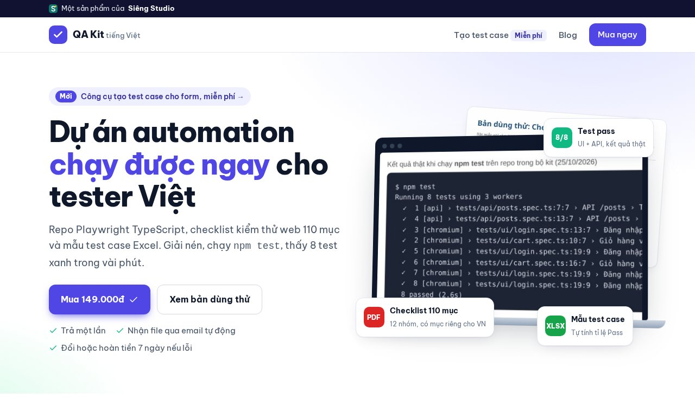

# Playwright Starter VN (bản lite)


Repo mẫu Playwright + TypeScript nhỏ gọn, có chú thích tiếng Việt, dành cho tester mới chuyển sang automation. Clone về là chạy được ngay trên trang demo [saucedemo.com](https://www.saucedemo.com).

## Có gì trong bản lite

- **Page Object Model**: `pages/LoginPage.ts`, `pages/InventoryPage.ts`
- **Fixture**: test nhận sẵn page object, không phải `new` lại mỗi lần (`tests/fixtures.ts`)
- **Test data-driven**: 4 test case đăng nhập, mã `TC-LOGIN-xx`
- **GitHub Actions**: file mẫu `docs/playwright.yml`, chép vào `.github/workflows/` trong repo của bạn để tự chạy test mỗi lần push và lưu HTML report
- Cấu hình sẵn trace, chụp màn hình khi fail, đổi môi trường bằng `BASE_URL`

## Chạy thử

```bash
git clone https://github.com/qakit-vn/playwright-starter-vn-lite.git
cd playwright-starter-vn-lite
npm install
npx playwright install chromium
npm test          # chạy 4 test đăng nhập
npm run report    # mở báo cáo HTML
```

Kết quả mong đợi:

```
  ✓  1 [chromium] › tests/ui/login.spec.ts › Đăng nhập › TC-LOGIN-01 đăng nhập thành công
  ✓  2 [chromium] › tests/ui/login.spec.ts › Đăng nhập › TC-LOGIN-02 báo lỗi: locked out
  ✓  3 [chromium] › tests/ui/login.spec.ts › Đăng nhập › TC-LOGIN-03 báo lỗi: do not match
  ✓  4 [chromium] › tests/ui/login.spec.ts › Đăng nhập › TC-LOGIN-04 báo lỗi: Username is required
  4 passed
```

Chạy trên môi trường khác: `BASE_URL=https://staging.example.com npm test`

## Cấu trúc

```
pages/            Page Object
tests/fixtures.ts Fixture dùng chung
tests/ui/         Test giao diện
docs/playwright.yml  Mẫu CI GitHub Actions
```

## Lỗi hay gặp khi mới chạy

| Triệu chứng | Cách xử lý |
| --- | --- |
| `Executable doesn't exist ... chromium` | Chạy `npx playwright install chromium` (trên Linux CI thêm `--with-deps`) |
| Test timeout ở bước `goto` | Mạng chậm hoặc trang demo đang lỗi: thử lại, hoặc tăng `timeout` trong `playwright.config.ts` |
| Test lúc pass lúc fail | Tìm `waitForTimeout` và thay bằng `expect(...).toBeVisible()`; mở trace bằng `npx playwright show-trace` |
| Locator tìm thấy nhiều phần tử | Dùng `getByRole('button', { name: '...' })` thay vì CSS chung chung, hoặc thêm `data-testid` |

## Áp dụng cho trang của bạn

1. Đổi `baseURL` (hoặc chạy `BASE_URL=https://trang-cua-ban npm test`).
2. Chạy `npx playwright codegen https://trang-cua-ban`, thao tác một luồng, copy locator sinh ra.
3. Tạo `pages/TenTrangPage.ts` theo mẫu `LoginPage.ts`, khai báo trong `tests/fixtures.ts`.
4. Viết test trong `tests/ui/`, mỗi test một mã `TC-...` để đối chiếu với file test case.

Đọc thêm (tiếng Việt): [Playwright TypeScript cho người mới trên Viblo](https://viblo.asia/p/playwright-typescript-cho-nguoi-moi-tu-cai-dat-den-page-object-fixture-va-test-data-driven-vbLbjRGpLnk)

## Bản đầy đủ: QA Kit tiếng Việt

Bản lite chỉ có phần đăng nhập. Nếu bạn cần bộ đủ dùng cho công việc, **[QA Kit tiếng Việt](https://qakit-vn.github.io/qakit)** (149.000đ, trả một lần) có thêm:

- Test giỏ hàng, luồng mua hàng và **test API** (GET/POST, kiểm tra schema)
- Checklist kiểm thử Web **110 mục** (bản lite miễn phí: [27 mục](https://github.com/qakit-vn/checklist-kiem-thu-web))
- File **Excel test case** mẫu, mã khớp với test tự động
- Hướng dẫn tiếng Việt từng bước, đổi hoặc hoàn tiền trong 7 ngày nếu file lỗi

[](https://qakit-vn.github.io/qakit)

Công cụ miễn phí: [Tạo test case tự động](https://qakit-vn.github.io/qakit/tao-test-case.html)

---

Một dự án của **[Siêng Studio](https://qakit-vn.github.io)**: công cụ nhỏ, làm việc thật nhanh hơn. Góp ý, báo lỗi: mở Issue hoặc email botmoney@mail.grokbot.com.
